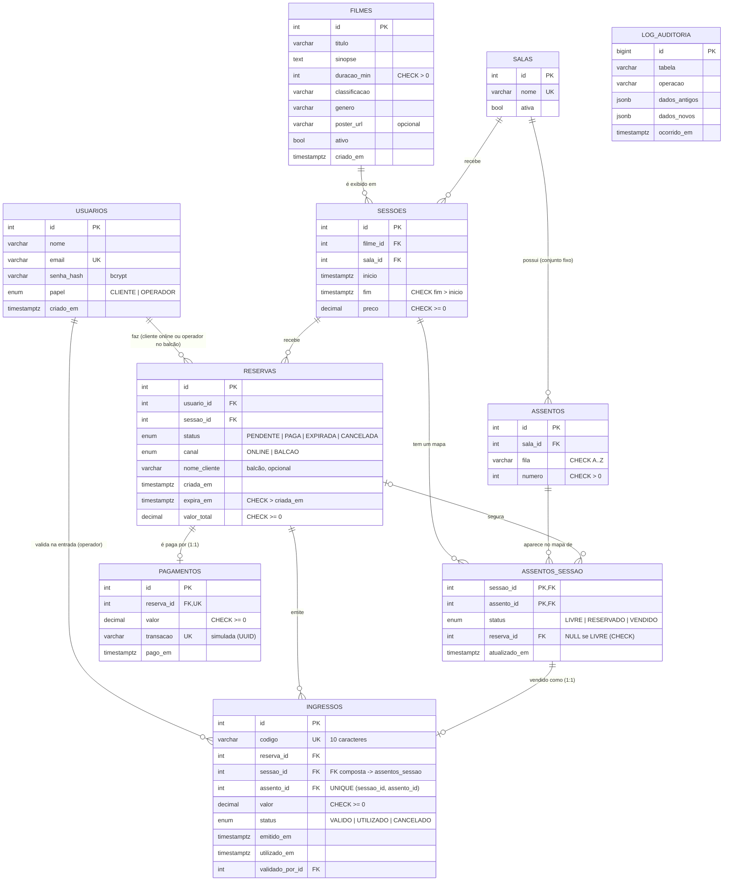

# CineON — Diagrama Entidade-Relacionamento

Modelo lógico implementado em [backend/prisma/schema.prisma](../backend/prisma/schema.prisma) e nas migrações em [backend/prisma/migrations](../backend/prisma/migrations).
O diagrama abaixo usa Mermaid, que o GitHub renderiza automaticamente.

## Chaves, constraints e índices

| Tabela | Objeto | Tipo | Para quê |
|---|---|---|---|
| todas | `*_pkey` | PK | identificação |
| `usuarios` | `email` | UNIQUE | login e cadastro sem duplicidade |
| `salas` | `nome` | UNIQUE | nomes distintos |
| `assentos` | `(sala_id, fila, numero)` | UNIQUE | conjunto fixo de assentos da sala |
| `sessoes` | `ex_sessoes_sala_sem_sobreposicao` | **EXCLUDE (GiST)** | duas sessões não ocupam a mesma sala em horários sobrepostos |
| `sessoes` | `(filme_id, inicio)`, `(inicio)` | índices B-Tree | sessões de um filme e listagem por período |
| `assentos_sessao` | `(sessao_id, assento_id)` | **PK composta** | **um único estado por assento em cada sessão** |
| `assentos_sessao` | `ck_assentos_sessao_reserva_coerente` | CHECK | LIVRE ⇔ sem reserva |
| `assentos_sessao` | `(reserva_id)` | índice | liberar/vender os assentos de uma reserva |
| `reservas` | `ix_reservas_pendentes_expira_em` | **índice parcial** | o job de expiração só olha as reservas pendentes |
| `reservas` | `(usuario_id, criada_em DESC)`, `(sessao_id)` | índices | consultas por usuário e por sessão |
| `pagamentos` | `reserva_id` | UNIQUE (1:1) | uma reserva tem no máximo um pagamento |
| `ingressos` | `codigo` | UNIQUE | código único, usado na validação |
| `ingressos` | `(sessao_id, assento_id)` | **UNIQUE + FK composta** | **o banco recusa um segundo ingresso para o mesmo assento da mesma sessão** |
| vários | `ck_*` | CHECK | preço, duração, número e valores não negativos; datas coerentes |

## Objetos programáveis

| Objeto | Tipo | Descrição |
|---|---|---|
| `trg_sessao_gera_mapa` | Trigger AFTER INSERT em `sessoes` | gera o mapa da sessão: uma linha LIVRE em `assentos_sessao` por assento da sala |
| `trg_auditoria_reservas` / `trg_auditoria_ingressos` | Triggers AFTER INSERT/UPDATE/DELETE | gravam o antes e o depois (JSONB) em `log_auditoria` |
| `sp_gerar_assentos_sala(sala, filas, por_fila)` | **Stored procedure** (`CALL`) | gera o conjunto fixo de assentos da sala (filas A, B, C… × 1..N) |
| `fn_relatorio_ocupacao(inicio, fim, filme)` | Função SQL com CTEs | relatório gerencial com **5 tabelas**: sessões, filmes, salas, assentos e ingressos |
